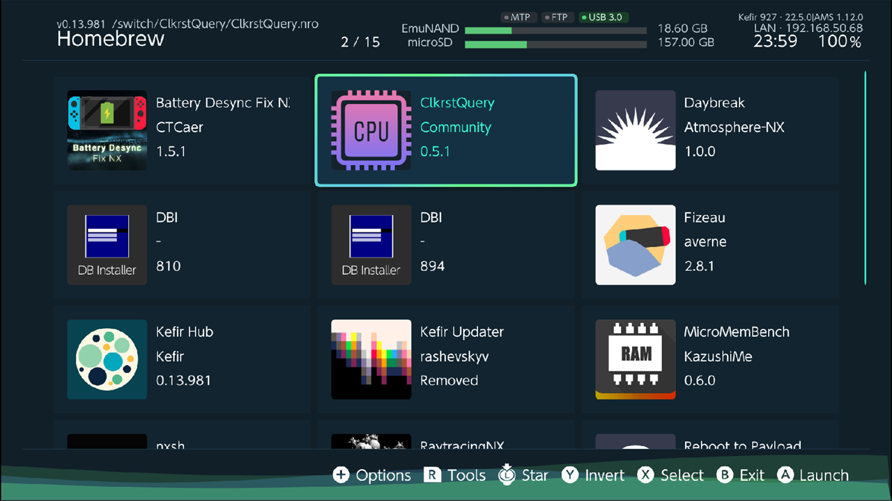
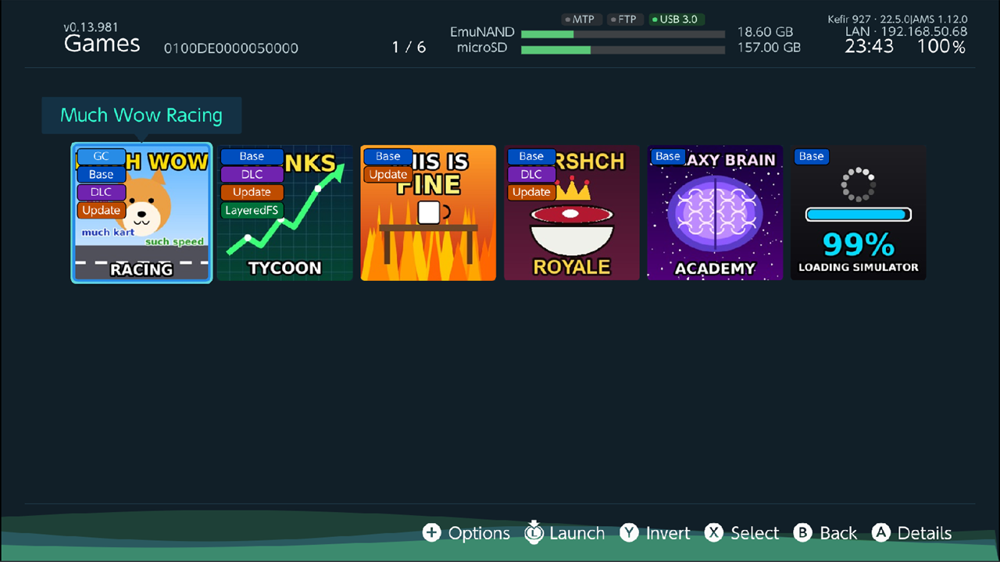
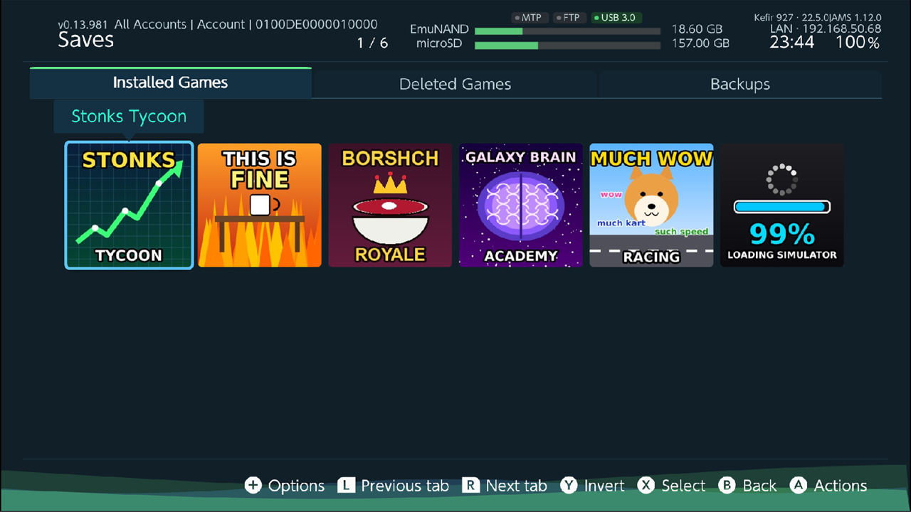
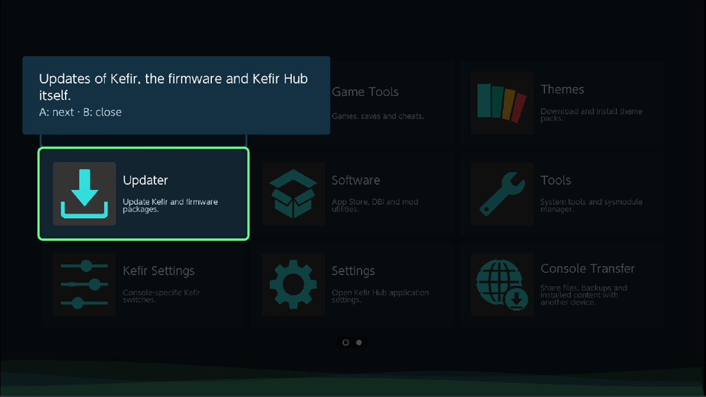
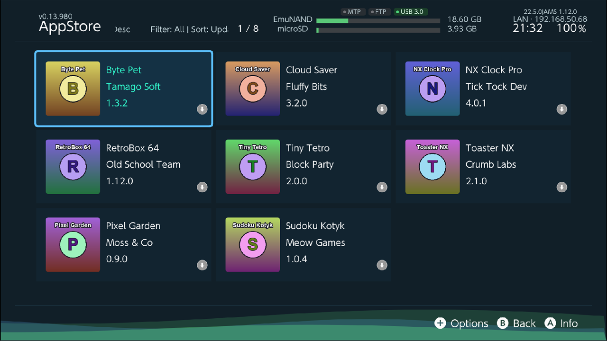
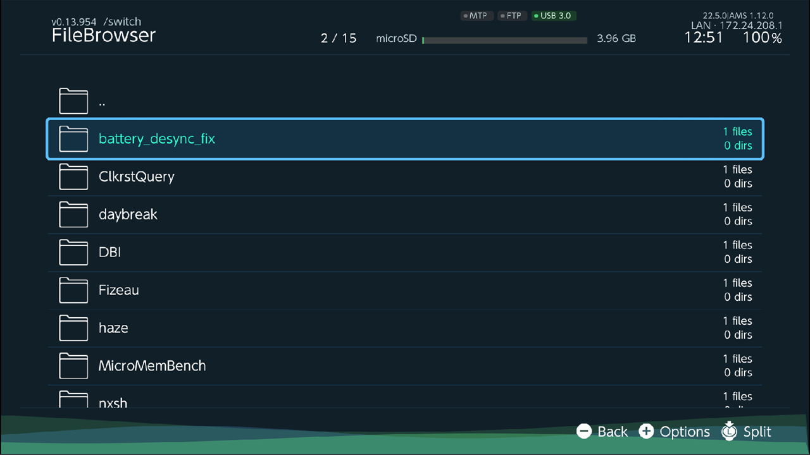
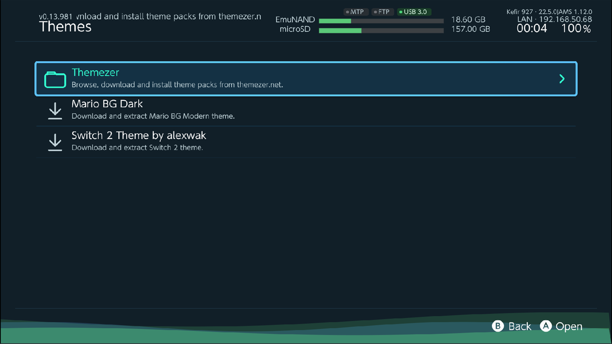
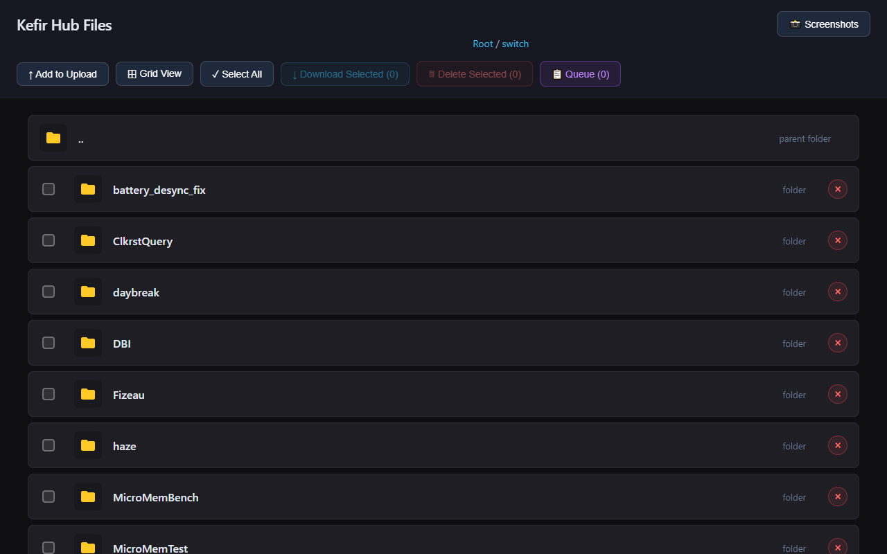
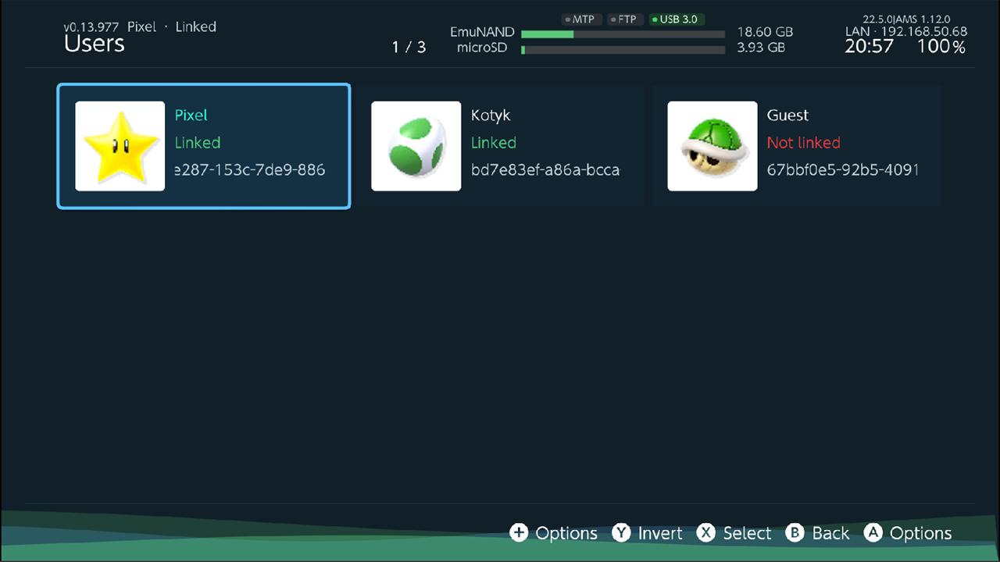
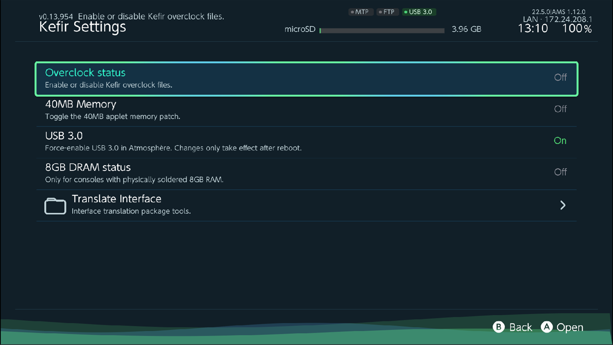

# Kefir Hub

Kefir Hub is a homebrew hub for the Nintendo Switch, based on the upstream Sphaira project.
It launches homebrew, installs games, manages saves, cheats, themes and user profiles, and shares files with a PC.
It is the app that comes with Kefir (documentation: [hub.customfw.xyz](https://hub.customfw.xyz/)), but it is **not Kefir-only**.
It also runs on plain Atmosphère with any other custom firmware pack.

**Kefir Settings** in the Tools tab show up only when Kefir is installed.
Kefir Hub looks for the version file `/switch/kefir-updater/version`. Without it, the item is hidden.
The **Updater** stays and offers **Install** for the Kefir pack instead of **Update**.

[See the GBATemp thread for more details / discussion](https://gbatemp.net/threads/sphaira-hbmenu-replacement.664523/).

[We have now have a Discord server!](https://discord.gg/8vZBsrprEc) Please use the issues tab to report bugs, as it is much easier for me to track.

## Showcase

|                          |                          |
:-------------------------:|:-------------------------:
 | 
 | 
 | 
 | 
 | 

## Languages

Kefir Hub speaks 26 languages. The first start asks for one; change it later in **Settings -> General -> Language**.

Belarusian, Chinese (Simplified), Chinese (Traditional), Dutch, English, English (UK), Estonian, French, French (Canada),
German, Indonesian, Italian, Japanese, Kazakh, Korean, Latvian, Lithuanian, Polish, Portuguese (Brazil), Portuguese (Portugal),
Spanish, Spanish (Latin America), Swedish, Turkish, Ukrainian, Vietnamese.

The documentation is available in English and Ukrainian.

## Bug reports

For any bug reports, please use the issues tab and explain in as much detail as possible!

Please include:

- CFW type (i assume Atmosphere, but someone out there is still using Rajnx);
- CFW version;
- FW version;
- The bug itself and how to reproduce it.

## Install

Copy `kefir-hub.nro` from the
[latest release](https://github.com/rashevskyv/kefir-hub/releases/latest) to `/switch/kefir-hub/kefir-hub.nro` on the microSD card
and launch it from the Homebrew Menu. Later releases are installed automatically in the background
(**Settings -> General -> Auto-update**, see [Automatic Silent Update](docs/wiki/System-and-Tools.md#8-automatic-silent-update--about)).

## Features

Full guides live in the [Documentation Wiki](docs/wiki/Home.md). One line per feature:

**Installing and transfers** — [Installation & USB](docs/wiki/Installation-and-USB.md), [Network & Web](docs/wiki/Network-and-Web-Services.md)
- PC Install (USB): DBI Backend with live SPHQ queue sync, Awoo/TinFoil and GoldLeaf, one screen for all of them.
- MTP: install by copying to the console, Games drive for NSP dumping, external MTP devices, storage names and visibility.
- Game installer: NSP/NSZ/XCI/XCZ from SD, gamecard, USB, MTP, FTP, Web and Ownfoil; storage priority and reserve threshold.
- Recursive folder install, review queue controls, R3 minimize badge, Minus screensaver with drifting readout.
- Web File Manager at `http://kefir.local`: SPA, transfer queue, direct install, ZIP download, screenshot gallery.
- Ownfoil client, FTP server, NX-Link, Remote Input from phone or PC, Wi-Fi connection manager.

**Saves and accounts** — [Save Management](docs/wiki/Save-Management.md), [User Profiles](docs/wiki/User-Profiles-and-Account-Link.md), [Console Transfer](docs/wiki/Console-Transfer.md)
- Save Hub: installed, deleted and backup tabs; Kefir Hub, DBI, JKSV and Checkpoint backups, ZIP or folder.
- Restore for uninstalled games, Restore All, Game Tools save-slot manager, raw NAND save drives, WebDAV sync.
- User profiles: creation, avatars, offline Nintendo Account linking from RomFS donors, Official vs Fake status.
- Console Transfer: profiles, play hours and save packs over Wi-Fi, with automated TegraExplorer dump/restore.

**System** — [Firmware & Downgrades](docs/wiki/Firmware-and-Downgrades.md), [System Utilities](docs/wiki/System-and-Tools.md)
- Firmware install from ZIP or folder, automated post-downgrade fix, theme and translation cleanup.
- Module Manager with RAM telemetry, fan curves with live preview, system interface translations.
- Forwarder Editor with SteamGridDB, themes and Theme Creator, DBI management, AppStore, auto-update, file association.

**Interface** — [Interface & Navigation](docs/wiki/Interface-and-Navigation.md)
- Tools hub, display layouts (Grid, HB Menu, List), status header, image viewer, file browser with SMB/WebDAV/FTP/HTTP sources.

Technical references: [Profile & Playtime Migration Deep Dive](docs/account-transfer.md).
Developers: [Developer Guide](docs/wiki/Developer-Guide.md), [CHANGELOG](docs/dev/CHANGELOG.md), [AGENTS.md](AGENTS.md).

## Building from source

You will first need to install [devkitPro](https://devkitpro.org/wiki/Getting_Started).

Next you will need to install the dependencies:
```sh
sudo pacman -S switch-dev deko3d switch-cmake switch-curl switch-glm switch-zlib switch-mbedtls switch-libarchive
```

Also you need to have on your environment the packages `git`, `make`, `zip` and `cmake`

Once devkitPro and all dependencies are installed, you can now build sphaira.

```sh
git clone https://github.com/ITotalJustice/sphaira.git
cd sphaira
cmake --preset MinSizeRel
cmake --build --preset MinSizeRel
```

The output will be found in `build/MinSizeRel/kefir-hub.nro`

## Credits

Kefir Hub is derived from Sphaira; upstream links and attribution are retained below.

- [borealis](https://github.com/natinusala/borealis)
- [stb](https://github.com/nothings/stb)
- [yyjson](https://github.com/ibireme/yyjson)
- [nx-hbmenu](https://github.com/switchbrew/nx-hbmenu)
- [nx-hbloader](https://github.com/switchbrew/nx-hbloader)
- [deko3d-nanovg](https://github.com/Adubbz/nanovg-deko3d)
- [minIni](https://github.com/compuphase/minIni)
- [GBATemp](https://gbatemp.net/threads/sphaira-hbmenu-replacement.664523/)
- [hb-appstore](https://github.com/fortheusers/hb-appstore)
- [haze](https://github.com/Atmosphere-NX/Atmosphere/tree/master/troposphere/haze)
- [nxdumptool](https://github.com/DarkMatterCore/nxdumptool) (for gamecard bin dumping and rsa verify code)
- [Liam0](https://github.com/ThatNerdyPikachu/switch-010editor-templates) (for ticket / cert structs)
- [libusbhsfs](https://github.com/DarkMatterCore/libusbhsfs)
- [libnxtc](https://github.com/DarkMatterCore/libnxtc)
- [oss-nvjpg](https://github.com/averne/oss-nvjpg)
- [nsz](https://github.com/nicoboss/nsz)
- [themezer](https://themezer.net/)
- Everyone who has contributed to this project!
